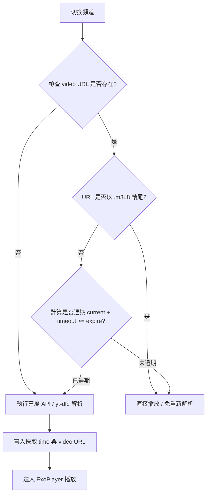

# 新聞直播 fork620 APP - 專案架構與計算原理分析報告

## 1. 專案背景與資料同步狀態

- **專案名稱**：新聞直播fork620 APP (androidtv-news-fork620)
- **原始開源來源**：[anenasa/androidtv-news](https://github.com/anenasa/androidtv-news)
- **當前版本**：`6.2.0` (commit: `bdba2c0`)
- **GitHub 倉儲**：`https://github.com/cs22study/androidtv-news-fork620`
- **本地路徑**：`D:\志松資料\GAS程式AI運用小松資料區cs22study\新聞直播fork620`
- **資料同步完成度**：已成功完成 Git 初始化、關聯遠端 `origin/main`、雙向追蹤與完整原始碼同步。

---

## 2. 核心技術架構與系統環境

| 項目 | 技術規格 / 函式庫 | 說明 |
| :--- | :--- | :--- |
| **開發語言** | Kotlin (Kotlin 2.4.21, JVM 17) | 現代化 Android 開發規範 |
| **Android SDK** | CompileSdk: 37, MinSdk: 23 (Android 6.0+), TargetSdk: 29 | TargetSdk 29 用於維持 Android TV 11+ 之 Legacy 外部儲存存取相容性 |
| **架構支援** | `armeabi-v7a`, `arm64-v8a` | 專為常見電視盒晶片 (如 Amlogic, Realtek, Allwinner 等) 編譯 |
| **影音播放器** | AndroidX Media3 ExoPlayer (`1.11.1`) | 支援 HLS (.m3u8), RTMP, MP4, Dash 及雙流影音動態合併 (MergingMediaSource) |
| **Python 內嵌核心** | Chaquopy (`17.2.0-anenasa`, Python 3.13) | 在 Android 本地環境執行 Python 直譯器 |
| **串流解析核心** | yt-dlp (動態下載 Nightly Binary) + ytdlp-ejs (`libejs.so` / QuickJS) | 破解 YouTube 等各大平台之 JS n-challenge / signature 演算法 |
| **備援/網頁播放** | Android WebView + JS 腳本注入自動化 | 針對有防盜鏈或需要互動點擊的平台直接全螢幕模擬渲染 |
| **崩潰日誌監控** | ACRA (`5.14.2`) | 本地日誌持久化至 `log.txt` |
| **資料序列化** | `kotlinx.serialization` (JSON) | 解析與生成頻道配置 JSON |

---

## 3. 專案核心設計與計算原理

### 3.1 頻道設定載入與層級覆蓋機制 (Hierarchy & Merging)

1. **基礎預設清單 (Base Config)**:
   - APP 啟動時先檢查本機 `getExternalFilesDir(null)/config.txt` 與內部私有目錄 `filesDir/config.txt`，並檢驗 `SharedPreferences` 備份。
   - 若本機均不存在，則透過網路下載預設清單。
   - **巢狀清單支援 (Recursive List)**：支援 `{"list": "URL"}`，可遞迴抓取遠端子頻道表。
2. **多重持久化與四重防護機制 (Multi-Tier Persistence)**:
   - `custom.txt` 與滾動備份 `custom.txt.bak` 同步寫入**外部儲存空間**與**內部私有儲存空間 (`/data/user/0/.../files/`)**。
   - 系統層級 `SharedPreferences` 自動維護全量 JSON 備份 (`custom_channels_json_backup`)。
   - 保證 APK 自動或手動覆蓋更新、外部快取清理或無 SD 卡存取時，使用者自建之頻道資料永久留存不遺失。
3. **Web 後台一鍵備份與匯出/匯入 (Export & Import)**:
   - 提供 `/api/channels/export` 支援一鍵下載完整頻道備份 JSON 檔。
   - 提供 `/api/channels/import` 支援上傳檔案或貼上 JSON 快速復原至電視並即時生效。
4. **本機自訂覆蓋 (Custom Overrides - `custom.txt`)**:
   - `customChannelList`: 針對預設頻道的覆蓋設定（名稱、自訂網址、格式、音量、Headers、隱藏狀態 `isHidden`）。
   - `newChannelArray`: 使用者在 APP 內自行新增的頻道清單。
5. **頻道號碼與索引計算**:
   - 頻道編號依清單順序排列，支援軟隱藏 (`isHidden = true`)，轉台時會自動略過隱藏頻道。

### 3.2 串流解析與動態過期計算原理 (Dynamic Extraction & TTL Cache)

為了避免每次切換頻道都耗費 2~8 秒重新執行 yt-dlp 解析，專案實作了智慧快取與 TTL (Time-To-Live) 計算機制 (`Channel.kt`):

#### 過期時間 (TTL) 計算公式：
- **Direct M3U8**: 無過期限制，快取永久有效。
- **YouTube 直播**: 提取視訊 URL 內之 `expire` 參數 (Unix Timestamp)：
  $$\text{expire} = \text{toLong}(\text{subString}(URL, \text{"expire"} + 1 \dots 10))$$
  判斷條件：當 $\text{currentTime} + \text{timeout} \ge \text{expire}$ 時觸發重新解析（前台 timeout 為 60 秒，背景預載 timeout 為 7200 秒）。
- **Hami Video / 4gtv / 民視**: 提取 URL 中的 `expires` 時間戳記。
- **Ofiii (歐飛)**: 固定 TTL 為 4 小時 ($\text{time} + 14400\text{s}$)。
- **其他平台**: 預設 TTL 為 2 小時 ($\text{time} + 7200\text{s}$)。

#### 平台特化解密流程 (Platform-specific Interceptors):
1. **Hami Video**: 直接呼叫 `api/play.do?freeProduct=1&id=...` 並補上 `Referer: https://hamivideo.hinet.net/`。
2. **4GTV (四季線上) / 民視 (FTV)**: 透過 Jsoup 爬取網頁取得 `ChannelId`，再呼叫 `GetChannelURL_Mozai.ashx` 取得動態 M3U8。
3. **Ofiii**: 透過 `api/deviceId` 獲取臨時裝置 ID，再呼叫 `cdi.ofiii.com` 取得授權串流。
4. **YouTube & 其他通用站點**:
   - 啟動 Python Chaquopy 載入 `yt_dlp` 模組。
   - 呼叫 `libejs.so` (QuickJS) 執行 JS 解密簽名。
   - 若回傳雙串流（分離之高畫質視訊與音訊 `bv*+ba/b`），在 Kotlin 端以 `\n` 分割後包裝成 `MergingMediaSource` 進行同步渲染。

### 3.3 網頁模擬與 WebView 整合原理 (WebView Mode)

當頻道標記 `isWebView = true`：
1. 停用 ExoPlayer，切換至 `WebViewHelper`。
2. 注入自訂 `cookies.txt` 與 HTTP Headers。
3. 頁面載入完成後 (`onPageFinished`)，注入執行 `scriptOnFinish` JavaScript。
4. 透過 `WebChromeClient.onJsPrompt` 攔截自訂通訊協定：
   - `prompt('tap:x,y')`：模擬螢幕指定百分比座標點擊。
   - `prompt('fullscreen:element')`：動態修改 DOM 元素樣式為 `fixed; z-index:999999; width:100%; height:100%` 達到無縫全螢幕播放。

### 3.4 電視遙控器與人機互動 (TV UX Logic)

- **方向鍵與頻道鍵**:
  - `DPAD_UP` / `CHANNEL_UP`: 下一台（可設定反轉）。
  - `DPAD_DOWN` / `CHANNEL_DOWN`: 上一台（可設定反轉）。
  - `DPAD_LEFT` / `DPAD_RIGHT`: 系統音量調節。
- **數字鍵選台**:
  - 連續按下數字鍵暫存於 `input`，畫面上顯示輸入號碼，按下 `OK/ENTER` 立即跳台。
- **選單互動**:
  - 播放中按 `OK/ENTER`：呼叫 `MenuFragment` 側邊/懸浮選單，提供「頻道表、頻道資訊、新增頻道、系統設定」。
- **觸控支援 (Touch Screen)**:
  - 點擊左側 1/3 螢幕：上一台。
  - 點擊中央 1/3 螢幕：開啟選單。
  - 點擊右側 1/3 螢幕：下一台。

---

## 4. Hub-and-Spoke 整合契機與 5 大原則落地指引

| 開發原則 | 目前專案現況 | 後續 Hub-and-Spoke 改造規劃 |
| :--- | :--- | :--- |
| **1. 自行撰寫與自動測試** | 目前專案完全無任何單元測試 (`app/src/test` 為空) | 建立完整 Kotlin/JUnit 自動化測試套件，涵蓋 URL 解析、TTL 過期計算、JSON 格式容錯測試。 |
| **2. 避免資料外洩與資安防護** | WebView 注入任意 script，且 config 依賴外部靜態網址 | 加入白名單域名鎖定、強化 XSS 驗證，配置檔與金鑰透過 GAS Hub 白名單與雲端驗證。 |
| **3. 隨時可復原 (軟刪除與雙向版控)** | 頻道刪除目前為直接移除 | 導入 `isDeleted` 軟刪除旗標，結合 Git 與 clasp 進行雙向版控。 |
| **4. 零花費 (Zero Cost)** | 原作者使用 GitHub Pages 託管預設清單 | 打造「Google Sheets (資料庫) + Google Apps Script (Hub API) + GitHub Pages (靜態/備援 Spoke)」全免費架構。 |
| **5. 節省 Token 與文件維護** | 專案缺少完整中文文件 | 建立 `docs/` 模組文件庫，每次改動精準回寫，節省跨對話脈絡成本。 |
